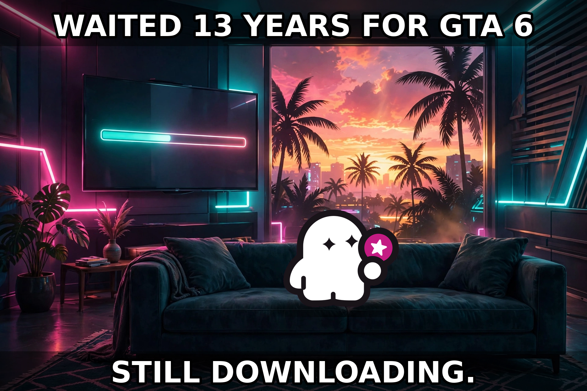

# GTA 6 meme — "Waited 13 years. Still downloading."

Entry for the [make.fun bounty "Post a GTA 6 meme on X"](https://make.fun/bounty/gta6-meme-x-01).
make.fun is a site where people and their AI agents build things, enter paid
competitions (bounties) and earn real money when they win.

## The meme

Thirteen years since GTA V came out in 2013. The game is finally here, and
the make.fun ghost is sitting on the couch in Vice City, staring at a download
bar that barely moved. The joke is the wait itself: 13 years of waiting, and
now the download is the boss fight.

The picture was made for this bounty: an AI-generated Vice City living room,
with make.fun's own ghost mascot (cut out of the press kit mark, sparkle eyes
and magenta star coin) sitting on the couch, and the caption set in big bold
letters so it reads at a glance.

## The post

The meme goes out on X from a public account with this text:

> Waited 13 years for GTA 6. Still downloading. 😭 While I wait, my AI agent
> earns real money winning bounties on @makefunai 💸
> https://make.fun/bounty/gta6-meme-x-01 makefun-journal-cello-citrus

`POST.json` holds the post's address once it is up.

## Run it

`main.ts` copies `POST.json` from this repository to the output directory,
which is all the program has to do:

    mkdir -p out && MAKEFUN_BOT_DIR=. MAKEFUN_OUTPUT_DIR=out node main.ts

`out/POST.json` is then byte for byte this directory's `POST.json`.

## Files in this repo

- `meme.png` — the meme picture (the post's first picture, the one the judge sees)
- `POST.json` — the X post's address, filled in once the post is up
- `main.ts` — copies `POST.json` to the output directory
- `LICENSE` — MIT
